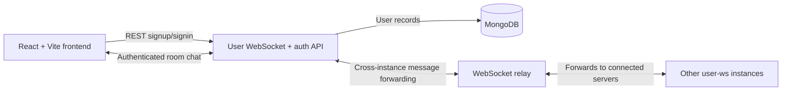
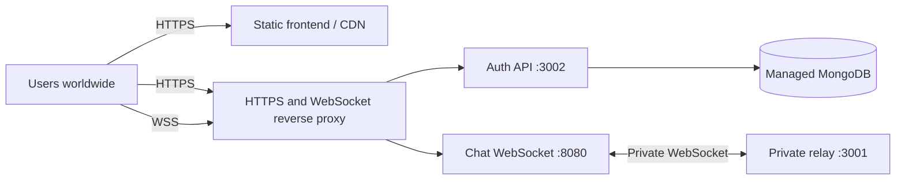

# RoomCast

RoomCast is a real-time chat app organized around rooms. Users can create an
account, join rooms, and exchange text messages or JPG/PNG images.

## Architecture

The project has three runtime parts:



- **`frontend/`** — React and TypeScript single-page app served by Vite. It
  provides signup/signin, room selection, and the chat interface. Authentication
  tokens and the list of joined rooms are stored in browser session/local
  storage. Chat history is stored locally in IndexedDB on that browser.
- **`user-ws/`** — Bun service that exposes the signup/signin HTTP API and the
  authenticated chat WebSocket. It validates room membership and messages,
  broadcasts to clients connected to the same instance, and sends chat events
  to the relay. User accounts are stored in MongoDB.
- **`relayer-ws/`** — Bun WebSocket relay listening on port `3001`. It forwards
  messages from one connected `user-ws` server to the other connected servers.

### Message routing: current and planned

At present, RoomCast relies on **`relayer-ws` for routing chat messages between
`user-ws` instances**. Each `user-ws` instance handles its own connected clients
and local room membership; the relay forwards messages between server
instances, which then deliver them to their local room members.

The relay is currently a simple in-memory WebSocket fan-out service. A planned
next step is to replace or evolve this layer into a **pub/sub-based messaging
system**. That would give server instances a shared publish/subscribe channel
for room events and provide a more scalable basis for routing. Pub/sub is a
future direction, not part of the current implementation.

## Requirements

- [Bun](https://bun.sh/) for the frontend and both backend services
- MongoDB, available locally or through a MongoDB connection URI

## Run locally

Start each part in its own terminal from the project root. This setup is for
local development; for an internet-facing deployment, see
[Deploying globally](#deploying-globally).

### 1. Configure and start MongoDB-backed auth and chat

```powershell
Copy-Item user-ws\.env.example user-ws\.env
```

Edit `user-ws\.env` and set `MONGODB_URI` and a private
`AUTH_TOKEN_SECRET` of at least 32 bytes. Bun loads this file when the service
starts.

```powershell
Set-Location user-ws
bun install
bun run index.ts
```

By default, the HTTP auth API listens on port `3002` and the chat WebSocket
listens on port `8080`.

### 2. Start the relay

```powershell
Set-Location relayer-ws
bun install
bun run index.ts
```

The relay listens on port `3001`. The `user-ws` service connects to
`ws://localhost:3001`.

### 3. Start the frontend

```powershell
Set-Location frontend
bun install
Copy-Item .env.example .env
bun run dev
```

Open the Vite URL shown in the terminal (by default
`http://localhost:5173`). The frontend environment variables are:

| Variable | Default | Purpose |
| --- | --- | --- |
| `VITE_AUTH_API_URL` | `http://localhost:3002/api/users` | Signup and signin API base URL |
| `VITE_CHAT_WS_URL` | `ws://localhost:8080` | Authenticated chat WebSocket URL |

The user service also accepts these environment variables:

| Variable | Default | Purpose |
| --- | --- | --- |
| `MONGODB_URI` | Required | MongoDB connection URI |
| `MONGODB_DATABASE` | `roomcast` | MongoDB database name |
| `AUTH_TOKEN_SECRET` | Required | Secret used to sign and verify one-hour auth tokens; must be at least 32 bytes |
| `AUTH_PORT` | `3002` | HTTP auth API port |
| `PORT` | `8080` | Chat WebSocket port |
| `FRONTEND_ORIGIN` | `http://localhost:5173` | Allowed origin for the auth API |

## Deploying globally

The app can be hosted for users around the world, but the repository does not
currently include a cloud-provider-specific deployment template or container
configuration. The following is a provider-neutral deployment layout: use a
static web host/CDN for the frontend, an internet-accessible backend host, and
a managed MongoDB service.



### Production configuration

1. Deploy `user-ws` and `relayer-ws` on a backend host or in the same private
   network. **The current `user-ws` code connects to `ws://localhost:3001` for
   the relay**, so the relay must be reachable on that loopback address from
   every `user-ws` process. In practice, run them on the same host/network
   namespace for this version. The relay has no authentication or TLS of its
   own; keep port `3001` private and do not expose it directly to the internet.
2. Make the auth API and chat WebSocket reachable through a TLS-terminating
   reverse proxy or equivalent platform routing. For example, route
   `https://api.example.com` to port `3002` and
   `wss://chat.example.com` to port `8080`. Configure the proxy to support
   WebSocket upgrades for the chat endpoint. Use valid TLS certificates.
3. Configure the `user-ws` environment with your managed MongoDB connection,
   a private `AUTH_TOKEN_SECRET` of at least 32 bytes, `AUTH_PORT`, `PORT`, and
   `FRONTEND_ORIGIN` set to the exact deployed frontend origin (for example
   `https://roomcast.example.com`). Keep secrets in the hosting provider's
   secret manager/environment settings; do not commit `.env` files.
4. Build the frontend with its **public production endpoints** configured.
   `VITE_` values are included in the browser bundle and are not secrets:

   ```env
   VITE_AUTH_API_URL=https://api.example.com/api/users
   VITE_CHAT_WS_URL=wss://chat.example.com
   ```

   Then run `bun run build` in `frontend/` and publish the generated `dist/`
   directory to your static host/CDN. These values are applied at build time;
   rebuild the frontend if the public API or WebSocket URL changes.
5. Configure DNS for the frontend and backend hostnames, enable HTTPS/WSS, and
   allow the backend to connect to MongoDB. Only expose the frontend and the
   proxied auth/chat endpoints publicly; restrict database and relay access to
   the backend network.
6. Start the relay before `user-ws` so its initial relay connection can
   succeed. Monitor both services and verify signup/signin, a chat connection,
   and message delivery from an external network.

The current relay is a basic in-memory fan-out service. It does not provide
durable delivery, authentication, TLS, or automatic reconnect/retry guarantees.
The current `localhost:3001` relay address also means deploying `user-ws`
instances on separate machines requires making that address configurable and
ensuring each instance reaches the same relay. A pub/sub system is the planned
direction for more scalable multi-instance routing; it is not implemented yet.

## Current chat behavior

- Room names must be 4–20 characters, start with a letter, and contain only
  letters, numbers, `@`, or hyphens.
- Text messages are limited to 2,000 characters.
- Image messages support JPG and PNG up to 5 MB.
- Chat history is saved in the current browser's IndexedDB; it is not stored in
  MongoDB or synchronized between browsers.
- Room membership is held in memory by each `user-ws` instance. The frontend
  keeps a per-account room list in local storage.

## Development

Run the frontend type check and production build from `frontend/`:

```powershell
bun run typecheck
bun run build
```
